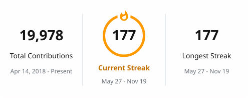
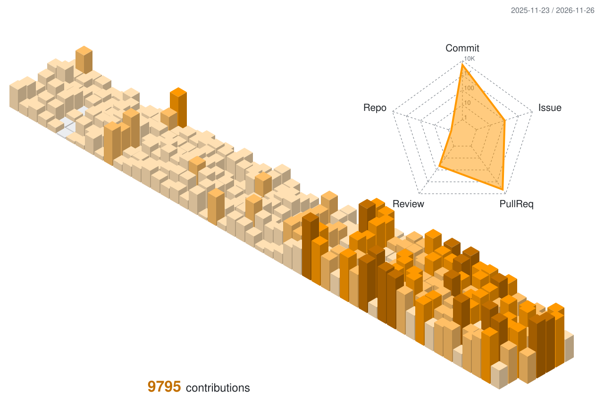

  

  

  
  
  
  

Senior DevOps and platform engineer with 7+ years building and running production systems on AWS, across fintech, AI infrastructure, healthcare, public sector and on-premise deployments. I design the cloud environment, codify it, build the CI/CD and monitoring around it, and write the application code that runs on it.

  <picture>
    <source media="(prefers-color-scheme: dark)" srcset="./profile/stats-dark.svg"/>
    
  </picture>
  <picture>
    <source media="(prefers-color-scheme: dark)" srcset="./profile/streak-dark.svg"/>
    
  </picture>

  <picture>
    <source media="(prefers-color-scheme: dark)" srcset="./profile/wakatime-dark.svg"/>
    
  </picture>

## 🚀 Some of what that's looked like

- ⚡ **CI/CD:** cut a fintech's CI cost about 3x and its 20,000-test suite from 12 minutes to under 4. Moved a hospital team's CI/CD from Jenkins to GitHub Actions in a HIPAA-aligned environment.
- 📈 **Scale and cost:** scaled a payments platform's throughput 10x while AWS spend stayed inside a fixed monthly budget, and cut backend latency 42%.
- 🏗️ **Infrastructure as code:** codified an AI company's estate across AWS, GCP and Cloudflare in AWS CDK and Pulumi, and ended a long-running configuration drift problem. Shipped Terraform and Terragrunt modules with Atlantis plan review across several client teams.
- ☸️ **Kubernetes:** standardized CI/CD across multiple clusters for national public-sector infrastructure serving 1M+ users. Built cert-manager ACME webhook services in Go.
- 🧰 **Platform tooling:** built a preview-environment platform that gave engineers a full environment on every pull request, and a multi-tenant cloud cost reporting service.
- 🩺 **Reliability:** traced an intermittent 5-second API latency to container DNS resolution order and fixed it, and designed a blue/green release process where rollback is a version repin and a restart.
- 💳 **Backend:** built payment features in TypeScript on Node.js: deposits, withdrawals and payouts across many processor integrations, signed webhooks, and duplicate-charge races closed and proven with concurrent tests.
- 🚚 **Migrations:** delivered 30+ AWS projects for Upwork clients, including zero-downtime moves off Heroku and Amazon Linux 1 for Django, Rails and Node apps.

## 🛠️ Stack

<table>
  <tr>
    <td><b>Cloud</b></td>
    <td> AWS (multi-account, EKS, ECS, Lambda, Step Functions, RDS, DynamoDB, CloudFront, WAF), GCP, Cloudflare</td>
  </tr>
  <tr>
    <td><b>Infrastructure as code</b></td>
    <td>  Terraform, Terragrunt, Atlantis, AWS CDK, Pulumi, CloudFormation</td>
  </tr>
  <tr>
    <td><b>Containers</b></td>
    <td> Kubernetes, Helm, cert-manager, Docker, Podman</td>
  </tr>
  <tr>
    <td><b>CI/CD</b></td>
    <td> GitHub Actions, GitLab CI, CircleCI, Jenkins, Ansible</td>
  </tr>
  <tr>
    <td><b>Observability</b></td>
    <td>  Datadog, Prometheus, Grafana, CloudWatch, ELK, Fluent Bit, Pyroscope</td>
  </tr>
  <tr>
    <td><b>Languages</b></td>
    <td> TypeScript, Python, Go, Bash</td>
  </tr>
  <tr>
    <td><b>Backends</b></td>
    <td>  Node.js (Express, NestJS), Django, FastAPI, Stripe</td>
  </tr>
  <tr>
    <td><b>Data</b></td>
    <td> PostgreSQL, MongoDB, Redis, DynamoDB, MySQL, SQS, BullMQ</td>
  </tr>
</table>

## 🌱 Open source

- [flash-oss/medici](https://github.com/flash-oss/medici), the double-entry ledger for Node.js: [Mongoose 9 support](https://github.com/flash-oss/medici/pull/124) and [configurable readConcern](https://github.com/flash-oss/medici/pull/120). 
- [kloia/platform-modules](https://github.com/kloia/platform-modules), Terraform modules: [configurable cost types](https://github.com/kloia/platform-modules/pull/265) in the AWS budget module. 

## 🏅 Certifications

  
  
  
  
  
  

- **AWStronaut:** 15 AWS certifications, including Solutions Architect Professional, DevOps Engineer Professional, Security Specialty and Machine Learning Specialty
- **Kubestronaut:** CKS, CKA, CKAD, KCSA and KCNA

All on [Credly](https://www.credly.com/users/vahiwe/badges).

## ✍️ Writing

Articles on [Medium](https://medium.com/@vahiwe) about AWS leader election, Parameter Store for Elastic Beanstalk, scheduled Lambda backups, Elastic Beanstalk SSL, and CI/CD for Django.

## 📅 The last year

  

## 🌍 Elsewhere

Based in Nigeria (UTC+1), with overlap into US mornings.

[Upwork](https://www.upwork.com/freelancers/~013a51f6b4615e86a5) · [LinkedIn](https://www.linkedin.com/in/vahiwe)

  

